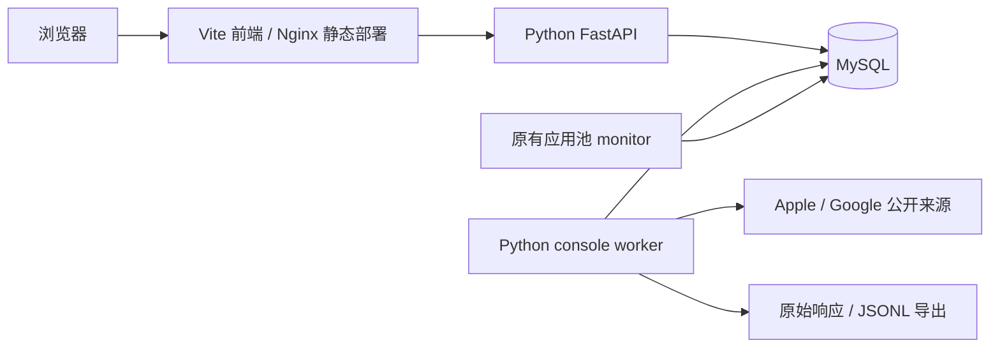

# 独立前端与应用情报 API

## 架构



`frontend/` 有独立 package.json、锁文件、构建、测试、Dockerfile 和 Nginx 配置。Python wheel 不包含前端文件。API 与采集 worker 独立运行，网页请求不会直接触发长时间商店抓取。原有全池 monitor 和关键词 daemon 仍可单独使用，并通过 MySQL 租约和共享限速协调。

## 功能与数据口径

后续扩展：新增 [五平台研究对应的业务工作流](platform-research-and-design.md)，包括持久草稿、评论处理、竞品集合、事件日历、开发者与采集质量。原有数据口径保持，下文基础模块与新增工作流共同组成控制台。

| 功能 | 实现 | 边界 |
|---|---|---|
| 应用池 | 精确分商店总数、搜索、分类/开发者/地区状态过滤、游标分页 | 总数缓存5分钟并显示统计时间；历史 ID 不代表现在在架；名称包含搜索可能扫描大表，精确 ID 使用主键 |
| 应用详情 | 商店资料、版本、评分历史、图标/截图/版本说明快照、逐字段变更 | 历史仅从本系统采集开始积累；素材保存来源 URL 和原始响应，未下载保存图片字节，原站删除后图片可能失效 |
| 重点监控 | 分组、独立地区/语言、周期、暂停/恢复、安排刷新 | 暂停重点任务不暂停单独运行的全池 monitor；工作进程和网络配额影响实际刷新时间 |
| 分类榜单 | 双商店免费/付费/公开畅销排行、分类/国家、历史快照、进出观察范围 | Apple RSS 最高200，Google请求最高500，实际数量由来源决定；无收入金额估算，来源不支持的组合明确记录失败 |
| 精品推荐 | Apple Today 结构化推荐卡片、关联应用、故事链接和观察历史 | 推荐卡片序号不是排行榜名次，不表示首次推荐时间；当前为 iPhone Today |
| 关键词 | 多国家多语言词库、批量导入、排名/变化/历史、反向覆盖 | 沿用首个搜索响应口径，不宣称全词库、全分页、真实搜索量 |
| 竞品 | 同商店/国家/语言的2–6个应用对比、关键词交集和首个应用缺口 | 只比较当前未过期的已跟踪关键词；没有观测不等于零流量 |
| 评论 | 双商店最近评论、游标/页码遍历、去重和编辑历史、星级分布、规则主题统计 | 每轮最多500条最近评论、最多10页；不承诺全历史。Apple RSS按地区返回，不承诺请求语言过滤 |
| 市场与开发者 | 已观察应用的分类/开发者分布、近30天事件 | 不宣称全球市场规模、份额、DAU、留存或用户画像 |
| ASO 核查 | 缺失元数据、过期关键词、明显排名下降、元数据候选词 | 规则可解释，不生成热度/难度/流量估算；候选词需人工审核 |
| 广告 | 带时间/来源/证据链接的广告观察导入；自有账户实际日报CSV/JSON导入 | 不自动枚举竞品全部投放，不使用自然排名冒充广告位；未连接 Apple Ads 账户 API |
| 告警与日报 | 规则、阈值、分组过滤、去重站内收件箱、已读、最近24小时摘要 | 仅处理规则创建后事件；当前通知是站内，不会自动发送邮件或外部消息 |
| 导出 | MySQL持久队列、流式JSONL、租约恢复、原子发布、带筛选下载 | 后台需运行且预留磁盘；最多显示100个近期导出任务 |

无下载/收入、用户量、热度或竞争难度估算。广告日报的展示、点击、安装和支出为用户导入的账户报表原值，币种分别保留，不擅自换算。

## 本地启动

后端、worker 从仓库根目录运行；MySQL沿用现有 `.env`。

```powershell
.\.venv\Scripts\python.exe -m pip install ".[test]"
.\.venv\Scripts\python.exe -m appmon web --port 8765
```

另开终端运行 worker（如网络需要代理，在该进程环境中设置现有代理变量）：

```powershell
.\.venv\Scripts\python.exe -m appmon console daemon
# 只运行一轮，每类最多5个任务：
.\.venv\Scripts\python.exe -m appmon console run --limit 5
```

在 `frontend/` 中执行 `npm ci`、`npm run dev`，访问 `http://127.0.0.1:5173/`。worker 每轮处理重点应用、观察目标、关键词、告警和一个导出；循环间隔10秒，失败退避且保留上次成功数据。API `/health` 只反映 API/数据库，工作台另显示 worker 心跳。

## 独立容器部署

在 `.env` 设置私密的 `APPMON_API_TOKEN`（至少32字符）；绑定非回环 API 时程序会强制检查。`APPMON_ALLOWED_HOSTS` 为允许访问的前端域名列表，逗号分隔，不含端口。默认仅 localhost/127.0.0.1。前端与 API 默认端口分别5173、8765，均只绑定宿主机回环地址。

```powershell
docker compose -f compose.yaml --env-file .env --profile console config --quiet
docker compose -f compose.yaml --env-file .env --profile console up -d --build mysql web console frontend
docker compose -f compose.yaml --env-file .env --profile console logs --tail 100 web console frontend
docker compose -f compose.yaml --env-file .env --profile console stop web console frontend
```

上述命令不启动全池 monitor，沿用原项目名、MySQL端口和持久化目录。需要HTTPS时由现有反向代理接入前端，不在本项目修改宿主机证书策略。容器中访问宿主机代理时使用容器可达地址，不使用127.0.0.1。

前端第一次访问受保护服务时输入令牌，换取8小时HTTP-only会话。非浏览器客户端传 `Authorization: Bearer ...`。令牌不存入前端构建或localStorage。生产静态服务和Python API各自设置CSP；API校验Host、Origin、请求来源和5MB请求体上限。

## API

接口定义在 `/api/openapi.json`（受相同鉴权保护）。主要资源：

- `GET /api/pool`、`/overview`、`/apps`、`/apps/{store}/{app_id}`。
- `GET/POST /api/watchlist`、`/targets`、`/keywords`；任务通过 `POST /api/control/{resource}/{id}` 暂停、恢复或安排刷新。
- `GET /api/targets/{id}?run_id=...`、`/keywords/{id}`、`/keywords/{id}/history`。
- `POST /api/compare`、`/suggestions`；`GET /api/reviews`、`/market`、`/daily`。
- `GET /api/alerts`、`POST /api/alerts/rules`、`POST /api/alerts/{id}/acknowledge`。
- `GET/POST /api/exports`、`GET /api/exports/{id}/download`。
- `GET /api/ads`、`POST /api/ads/observations/import`、`POST /api/ads/reports/import`。

列表有明确上限：应用每页最多200，评论每页100，任务列表最多2000，榜单历史/详情快照最近100。大数据使用异步JSONL导出。所有存储时间为UTC epoch，界面按浏览器本地时区显示。

## 开源参考

- [MrAdex77/google-play-scraper](https://github.com/MrAdex77/google-play-scraper)：榜单 `vyAe2`、评论 `UsvDTd` 和结构映射，MIT；固定来源与版权见 THIRD_PARTY_NOTICES。
- [facundoolano/app-store-scraper](https://github.com/facundoolano/app-store-scraper)：Apple榜单/评论结构，MIT；旧地址替换为HTTPS RSS。
- [AsoBeast](https://github.com/AsoBeast/asobeast)：市场分离、观察证据、竞品与ASO核查流程参考，没有复制AGPL源码。
- [AppGoblin adscrawler](https://github.com/appgoblin-dev/adscrawler)：应用发现与持续历史采集结构参考。

验证记录见 [console-verification.md](console-verification.md)。
