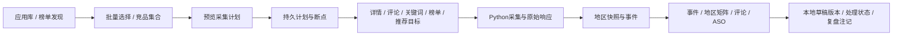

# 观星研究工作台设计

## 页面内容和展示方式

| 页面 / 用户问题 | 放置内容 | 展现与操作 | 已实现的数据依据 |
|---|---|---|---|
| 应用库：哪些产品值得研究？ | 官方分类、地区状态、评分、评分数、免费/付费、商店更新/发布日期 | 分类数量侧栏＋筛选工具栏＋勾选表格；批量监控最多50个、竞品2–6个 | 原应用池和对应地区listing；未知指标不填0；日期仅过滤可识别ISO日期或UTC时间戳 |
| 应用详情：各市场版本是否一致？ | 国家/语言、版本、地区状态、售价及币种、累计评分、成功时间 | 地区版本矩阵，可点击切换同一应用的地区；原有版本/素材历史保留 | 实际采集的listings、snapshots；未出现的地区是未知 |
| 事件中心：最近改了什么？ | 首次验证、资料变化、地区不可用/恢复、变更字段、关注组、人工复盘说明 | 7/30/90/365天筛选；按日观察日历；事件列表；前后文本和素材对照；带证据链接的人工注记 | events的观察时间；人工注记独立存储，既不伪装采集事件，也不推断因果 |
| ASO工作台：文案如何准备和复盘？ | 已采文案、缺失字段说明、基准快照、草稿名称、修改说明、关键词文本覆盖和实际排名 | 左侧编辑、右侧文案预览和核查；实时长度计数；保存/另存；加载历史后生成新修订 | 公开快照＋用户提供字段＋已维护词库；所有草稿本地保存，未发布 |
| 竞品集合：如何持续复用比较？ | 集合名称、同商店/国家/语言成员、自有或对照角色、资料、关键词交集/缺口、近期事件 | 保存命名集合；资料矩阵＋关键词矩阵＋动态表；一键生成集合监控计划 | 现有观察数据；不把跨商店排名相加；“自有”由用户主动指定，不自动认定 |
| 评论记录：每个应用有哪些已采集评论？ | 原文、星级、版本、发表/观察时间、已采集公开回复 | 条件筛选＋样本统计＋评论卡片＋只读详情＋采集历史 | reviews与observation_items；不提供内部处理、分派或回复 |
| 开发者：有哪些已知产品？ | 商店开发者ID、公开名称、已观察应用数、市场数、最新成功 | 开发者表格，下钻产品×地区版本表 | 按商店开发者ID归并；无ID时仅提供公开名称筛选，不认定跨商店公司关系 |
| 采集中心：数据是否可靠、下一步采什么？ | 来源、字段、边界、周期、成功/尝试时间、深度、过期、错误、计划进度 | 质量卡片＋目标列表＋来源方案卡；预览计划后确认入队；失败从断点重试 | 持久任务和实际请求/运行记录；“已配置”与“已采集”严格区分 |

已有榜单、精品推荐、关键词历史、市场分布、广告证据/实际报表、告警和导出继续保留。导航结构见 [平台工作区](platform-structure.md)。

## 工作流与持久化

新增表：`aso_drafts`、`aso_draft_versions`、`review_workflow`、`comparison_sets`、`event_annotations`、`collection_plans`。数据库启动幂等创建，不重建原应用池。

- ASO草稿与修订在同一事务保存，保留基准快照。更新必须提供当前revision，过期编辑被拒绝；允许保存超长草稿，但核查结果明确标出问题。
- 评论仅作采集档案：当前记录与采集历史保留，公开回复如有则作为原始记录展示。原处理工作流已停用，历史 `review_workflow` 表仅保留兼容，不参与查询或写入。
- 计划预览不写数据库。确认后保存精确动作清单，worker每轮最多展开20个配置动作；每个动作通过已有幂等函数完成后记录进度。中断后重放不重复创建目标，已有暂停状态保留。
- MySQL命名锁防止多个worker同时展开计划。目标配置完成后才由已有租约/限速采集执行；计划成功不等于上游抓取成功。
- 新增请求索引支持重点池最近一次尝试查询。失败尝试时间与上次成功时间分别展示。

## 数据采集方案

| 数据域 | 来源 / 方式 | 建议配置起点 | 校验与保留 |
|---|---|---|---|
| 应用池发现 | 已有AppGoblin基线、官方榜单/搜索/开发者入口 | 基线周期检查，重点池单独调度 | ID去重、源文件哈希、首次发现≠新上架 |
| 地区详情与素材 | Apple lookup、Google Play公开详情 | 重点应用24小时；发布密集期可手动缩短 | 保存版本、描述、图标/截图URL与原始响应；素材文件未作永久字节归档 |
| 关键词 | 已维护词库、双商店公开有序搜索 | 重要词可6小时，一般词24小时 | 记录source/parser/coverage、实际深度；失败不覆盖成功记录 |
| 官方分类榜单 | Apple RSS、Google vyAe2 RPC | 重要分类6–24小时 | 同商店、国家、榜类下比较；掉出范围不等于下架 |
| 评论 | Apple RSS、Google UsvDTd RPC | 重点应用6–24小时 | 每轮有限近期窗口，保留编辑历史；没有回复字段为unknown |
| 精品推荐 | Apple Today结构化公开页面 | 24小时 | 保存卡片、故事、应用关联；卡片位置不是排行榜名次 |
| 自有后台数据 | 用户导入或未来官方授权连接器 | 按报表日期/授权配额 | 当前已有广告实际报表导入；后台关键词可用户填写；没有连接竞品私有账户 |

上述周期是配置起点，不是吞吐或实时完成承诺。继续使用现有MySQL共享商店限速、Retry-After、错误退避、租约和原始响应留存。重点池、关键词、榜单和评论可以独立执行；千万级多市场全量依赖授权批量数据源和容量规划，不能以增加worker承诺每日全量。

ASO长度规则依据：[Apple应用信息](https://developer.apple.com/help/app-store-connect/reference/app-information/app-information/)、[Apple版本信息](https://developer.apple.com/help/app-store-connect/reference/app-information/platform-version-information/)、[Google商店详情](https://support.google.com/googleplay/android-developer/answer/9859152?hl=en)。Apple关键词按100 **UTF-8字节**核查；标题/副标题30字符，描述4000；Google标题30、短描述80、完整描述4000。核查是本地长度/重复/文本包含检查，不是商店审核结果或排名保证。

## 当前明确没有实现的能力

下载/收入、搜索热度/难度、DAU/留存、市场份额等预估继续排除。没有自动发布元数据、回复评论、发送外部邮件或连接开发者账户。SDK扫描需要另行配置合法安装包来源；第三方算法异动、竞品完整广告投放和用户画像没有伪造。公开接口无法得到的字段保持空缺或要求用户提供。

本次为现有公开观察增加实际可用的研究与处理流程；研究中涉及的其他商业能力仅作为边界记录，不用“即将上线”空页面替代实现。
